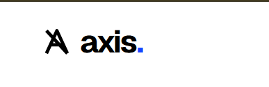
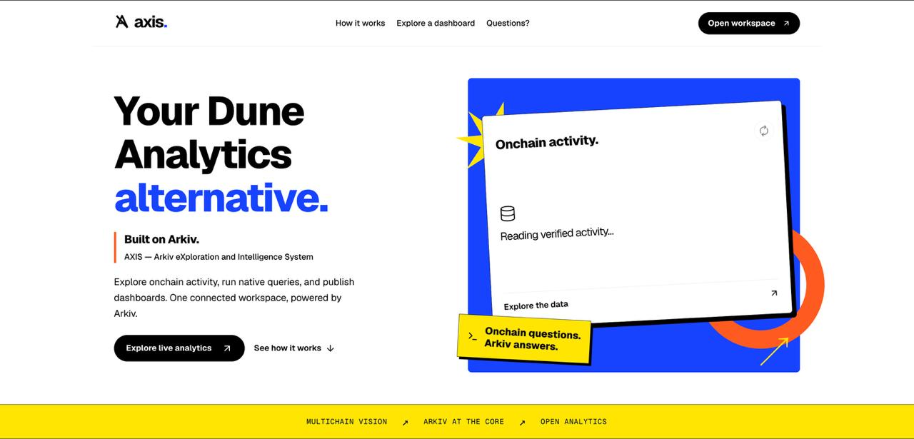
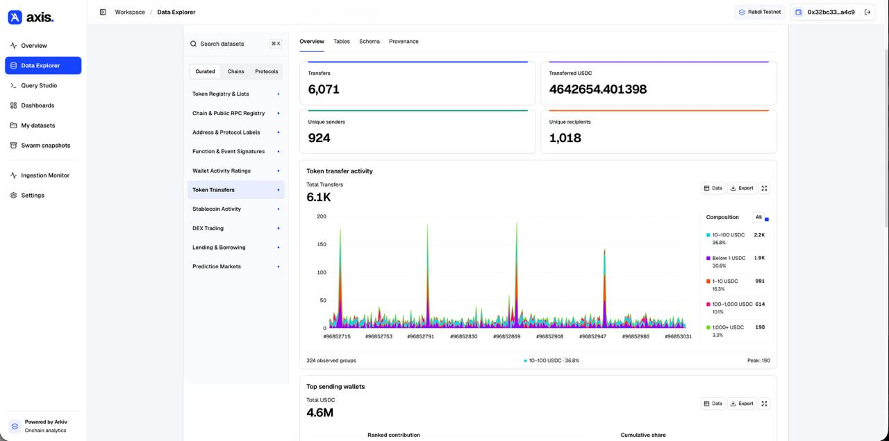
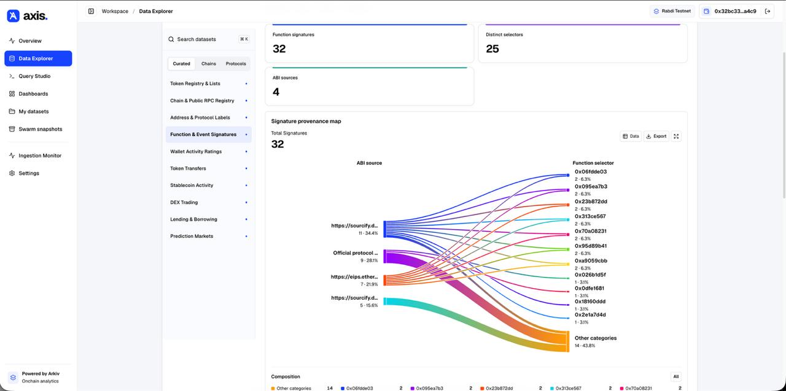
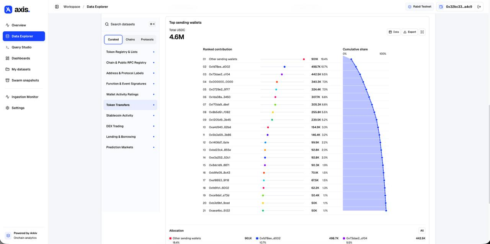
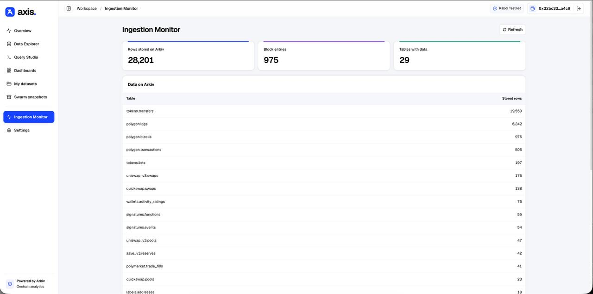
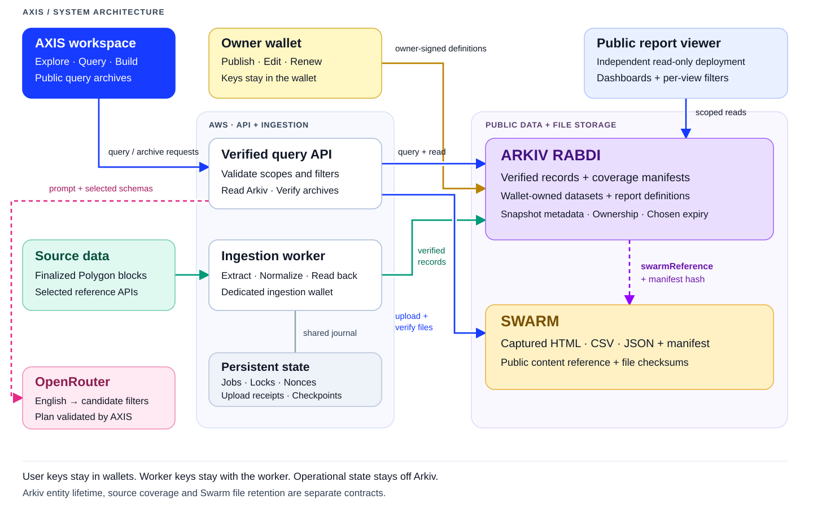

> [!IMPORTANT]
> **ETHGlobal Mumbai 2026 — tracks we are applying for**
>
> - **[Mirror something Ethereum depends on](arkiv/how-you-use-arkiv.md)** — our main track: Pick public data that Ethereum apps and developers rely on, and mirror it into Arkiv
> - **[Arkiv + Swarm bonus (from scratch)](arkiv/swarm.md)** — public query archives on Swarm, referenced and verified through Arkiv entities.

<p align="center">
  
</p>

<h1 align="center">Arkiv eXploration &amp; Intelligence System</h1>

<p align="center">
  <strong>Onchain analytics. Wallet-owned reports.</strong><br>
  Explore verified records, ask a question, and publish a dashboard.<br>
  Built on <strong>Arkiv</strong>, with public query archives on <strong>Swarm</strong>.
</p>

<p align="center">
  <a href="https://axis-platform-e7ac45525b.vercel.app"><strong>Open workspace ↗</strong></a>
  &nbsp; · &nbsp;
  <a href="https://axis-reports-e7ac45525b.vercel.app/d/0xcb7fccae9b8fd715ce0a465687b0e189efb324ce83d07bfd95b781e2902e40c6"><strong>View public dashboard ↗</strong></a>
  &nbsp; · &nbsp;
  <a href="https://bah5acgzaour3xpm3cf6bhox4s6wqeulr46ybuzpvskyfp4qh5oug5wvknnea.bzz.limo/"><strong>Open Swarm archive ↗</strong></a>
</p>

<p align="center">
  <a href="https://docs.arkiv.network/"></a>
  <a href="arkiv/swarm.md"></a>
  <a href="LICENSE"></a>
</p>

<p align="center">
  <a href="#why-axis">Why AXIS</a> ·
  <a href="#what-you-can-do">Features</a> ·
  <a href="#in-action">Screenshots</a> ·
  <a href="#architecture">Architecture</a> ·
  <a href="#technical-design">Technical design</a> ·
  <a href="#run-locally">Run locally</a> ·
  <a href="#for-arkiv-judges">Arkiv submission</a>
</p>

<a href="https://axis-platform-e7ac45525b.vercel.app">
  
</a>

## Why AXIS

AXIS is a decentralized alternative to Dune Analytics, transforming real blockchain data into publicly queryable Arkiv datasets, enabling users to explore onchain activity, create custom analytics, and publish wallet-owned dashboards.

The first audience is **Polygon treasury operators, protocol contributors and analysts** who need to investigate activity and share a recurring view. For example: find transfers above 100 USDC, inspect the sending wallets, compare concentration, and publish a report a teammate can open without connecting a wallet.

| What the user needs | What AXIS provides | Why it matters |
| --- | --- | --- |
| A quicker path from a question to records | Manual indexed filters or English-to-filter planning, followed by the actual result table | Users can inspect the returned records before turning them into a visual. |
| A report they control | Wallet-owned dataset and dashboard definitions in Arkiv | The report definition can be read independently of our interface; updates require its owner's signature. |
| Numbers with a declared scope | Verified block bounds, record counts, publisher identity and query provenance | A chart does not silently imply complete chain history or hide missing source records. |
| A shareable working view | A separate public viewer with per-visitor filters and live refresh | Teammates can explore a published report without changing its saved definition. |
| A captured answer that will not turn into tomorrow's query | Swarm archives containing exact CSV/JSON exports, an HTML report and a checksummed manifest | A shared archive preserves the captured result instead of substituting a fresh live read. |

Arkiv supplies the shared, queryable entities and wallet ownership. Swarm supplies the larger report files. The web application connects those pieces into one workflow: **explore → query → inspect → build → publish → archive**. [Audience and next steps](arkiv/reach.md).

## What you can do

AXIS takes a question about onchain activity and turns it into a report you can share. Dataset definitions, published reports, source records and verified coverage live in Arkiv. The current Query Studio and saved-report workflow focus on **Polygon USDC**; the explorer also reads scoped protocol and reference collections.

<table>
  <tr>
    <td width="50%" valign="top">
      <h3>Explore the actual data</h3>
      <p>Browse curated collections with charts, exact-value tables, field schemas and source provenance. See what is covered before trusting a total.</p>
      <a href="https://axis-platform-e7ac45525b.vercel.app/explore">Open Data Explorer →</a>
    </td>
    <td width="50%" valign="top">
      <h3>Ask in English or build filters</h3>
      <p>Describe the records you want, review the generated filters and execute the native Arkiv query. Manual controls remain available.</p>
      <a href="docs/getting-started.md#ask-in-english">How English queries work →</a>
    </td>
  </tr>
  <tr>
    <td width="50%" valign="top">
      <h3>Own and share the report</h3>
      <p>Save a query scope as a dataset, build a dashboard and publish its definition with your wallet. Readers can open its public URL without signing a transaction.</p>
      <a href="docs/dashboard-websites.md">Public dashboard websites →</a>
    </td>
    <td width="50%" valign="top">
      <h3>Keep a captured result on Swarm</h3>
      <p>Archive verified rows as CSV, JSON and a standalone HTML report. An Arkiv entity points to the public files and their manifest checksum.</p>
      <a href="arkiv/swarm.md">Archive flow and live proof →</a>
    </td>
  </tr>
</table>

## In action

### Activity, composition and exact values

<a href="docs/images/axis-token-activity.jpg">
  
</a>

### Relationships and wallet concentration

<table>
  <tr>
    <td width="50%" valign="top">
      <a href="docs/images/axis-signature-provenance.jpg"></a>
      <p><strong>Signature provenance</strong><br>Follow the relationship between ABI sources and observed function selectors.</p>
    </td>
    <td width="50%" valign="top">
      <a href="docs/images/axis-wallet-concentration.jpg"></a>
      <p><strong>Wallet concentration</strong><br>Compare ranked contributions with cumulative share in one analytical view.</p>
    </td>
  </tr>
</table>

### See what is actually stored

<a href="docs/images/axis-ingestion-monitor.jpg">
  
</a>

<sub>These are the original product screenshots supplied for this README. Displayed counts are captures from that moment; live data can change. Click any screenshot to open the full image.</sub>

## Architecture

<a href="docs/images/axis-architecture.svg">
  
</a>

1. **Verify the source.** The worker extracts finalized Polygon data, writes records to Arkiv, reads them back and publishes verified coverage.
2. **Query and publish.** The API validates source scopes and filters. A user's wallet signs its dataset and dashboard definitions; the public viewer reads them independently.
3. **Archive the result.** Swarm holds captured report files. Arkiv holds their public reference and checksum. English translation receives the request and selected schemas, not stored record payloads.

The API and worker keep operational state on persistent disk. User signing keys stay in their wallets; the ingestion key stays with the worker. Entity expiry, source-provider trust and Swarm retention remain separate concerns.

[Architecture and trust boundaries](docs/architecture.md) · [Editable Mermaid source](docs/architecture.mmd) · [Deployment details](docs/deployment.md)

## Technical design

### A typed data model with separate owners

AXIS uses `@arkiv-network/sdk` to write and query entities on **Arkiv Rabdi (chain 7794095)**. Its imported Polygon records describe **chain 137**. Queryable fields live in typed, indexed columns; larger definitions and lossless source payloads live in entity documents.

| Entity | Role in the application | Ownership and update model |
| --- | --- | --- |
| `axis.transfer.v1` | Exact USDC transfers, filtered by dataset, block, wallet, timestamp and raw amount | Ingestion-wallet owned; attributes are created readonly. |
| `axis.coverage.v1` | Verified source intervals, expected row counts and content/readback evidence | Ingestion-wallet owned and readonly; analytics check the available rows against it. |
| `axis.dataset.v1` | A source definition or saved query scope with frozen bounds and filters | User-wallet owned; saving a scope reuses the underlying records rather than copying a private table. |
| `axis.dashboard.v1` | Queries, visual configuration, titles, layout and refresh interval | User-wallet owned; the public viewer reads the same published document. |
| `axis.bulk.import.v1` / `axis.bulk.record.v1` | Committed source prefixes and scoped protocol/reference records | Import manifests advance after verified readback; published record attributes are readonly. |
| `axis.snapshot.v1` | Swarm collection reference, manifest checksum and captured source metadata | Publisher-wallet owned; readers verify the referenced files before displaying archived rows. |

Owning a dashboard or dataset definition does not grant permission to rewrite the imported records. Definitions and analytical records initially request 30-day lifetimes; job-status entities use seven days. Renewal is explicit, and a definition can outlive its sources. [Complete schemas, indexed fields and retention](arkiv/schema.md).

### Native predicates, with verified source boundaries

The server loads the selected definition, validates its trusted writer and coverage, and compiles a native Arkiv predicate. Address, time and amount controls follow the dataset's observed field schema. When several sources are selected, each keeps its own bounds and filters inside a parenthesized OR branch.

For example, **strictly above 100 USDC** becomes `amountRaw >= u256(100000001)` because USDC uses six decimal places. A compiled predicate over a previously checked source interval looks like this:

```sql
arkiv.schema = str('axis.transfer.v1')
AND $owner = addr(0xe7ac45525bd9fec84902371aaa65cf53c7d89909)
AND datasetKey = key(0x0c190ee3773030e0ada7b23d11717ee99a86adc4e7c4478c23e87149a653b89b)
AND blockNumber >= u64(96864289)
AND blockNumber <= u64(96864708)
AND amountRaw >= u256(100000001)
ORDER BY blockNumber:u64 DESC
```

The bounds above illustrate a recorded verified scope, not an assertion that it is the latest import. English mode produces a structured candidate plan through OpenRouter; local validation checks fields, types, source identities and constraints before compiling the same query path. Ambiguous or unsupported requests require clarification. The model does not supply records or calculate chart totals. [Query compiler](src/lib/axis/store.ts) · [English-plan validation](src/lib/axis/english-query.ts).

### Exact values and verified publication

Transfer amounts are retained as integer base-unit strings and calculated with `BigInt`. The displayed token amount is formatted from those values; chart coordinates may be approximate, while tooltips, data tables and exports preserve exact values. Complete analytics use the matching verified scope, rather than presenting the current 25-row table page as a whole-dataset total.

The worker extracts a finalized source interval, normalizes records, publishes them in batches and reads them back. Coverage advances only after the intended interval passes verification. Bulk readers additionally constrain the trusted owner, import key, committed ordinal prefix and source block range. Restart recovery reconciles existing identities and pending nonces before retrying writes. Missing rows, coverage gaps and failed readback stop the normal analytical result. [Ingestion implementation](src/lib/axis/ingestor.ts) · [Bulk publication contract](docs/bulk-publication.md).

### Fresh reads, fast revisits

| Layer | Implementation |
| --- | --- |
| RPC requests | Reused SDK reader, identical in-flight read sharing and at most eight concurrent node reads per server process |
| Query payloads | Count-only verification, minimal transfer projections and schema probes without full record payloads |
| Large result scans | Four disjoint key ranges, cursor pagination within each, ordered results and a shared 20,000-row cap |
| Browser navigation | Bounded memory/session caching; older views refresh in the background, while explicit Execute/Refresh actions fetch fresh data |
| Failure handling | A failed scan rejects the complete analytics result; a failed background refresh keeps the last successful visual with an error notice |

On one **7,380-transfer live scope**, local analytics improved from **51.4 seconds to 20.9 seconds**, and a separate sequential scan matched every aggregate. This is an observed measurement, not a latency promise for every dataset. Multi-page reads still use the latest block per request; final count checks do not make them a block-pinned snapshot. [Benchmark command and implementation](scripts/axis-read-benchmark.ts) · [Performance and cache details](docs/architecture.md#query-performance).

### A public reader and an independently checked archive

The workspace frontend runs on Vercel and proxies to a persistent AWS API. The ingestion worker and durable operational state run on that server. The separate public-report deployment has read-only endpoints restricted to source datasets referenced by the selected report. User signing keys stay in their wallets, and the worker signing key is not supplied to the website.

Archiving takes a full verified query export and builds `results.json`, `results.csv`, `index.html` and `manifest.json`. After upload, the server independently downloads and checks the remote files. The Arkiv snapshot entity holds `swarmReference` and `manifestSha256`; later archive reads check ownership, manifest integrity, file hashes, sizes and captured scope. Only public archives are supported: encrypted references containing decryption keys are rejected. [Archive implementation and real proof](arkiv/swarm.md).

## Run locally

Use **Node.js 24** and npm, the versions used for local validation. In a fresh checkout:

```powershell
npm.cmd ci
if (-not (Test-Path .env.local)) { Copy-Item .env.example .env.local }
```

Add the read settings to `.env.local`:

```dotenv
ARKIV_ACCESS_KEY=your_arkiv_access_key
AXIS_INDEXER_ADDRESS=0xe7ac45525bd9fec84902371aaa65cf53c7d89909
```

```powershell
npm.cmd run dev
```

Open **[localhost:3000](http://localhost:3000)**. Get an access key from the [Arkiv Hub](https://hub.arkiv.network/access-keys). Browsing existing data does not need the ingestion private key. Publishing your own report requires a funded Rabdi wallet; English input also needs server-side OpenRouter configuration.

[Complete setup guide](docs/getting-started.md) · [English query settings](docs/getting-started.md#ask-in-english) · [Worker and upload setup](docs/getting-started.md#worker-and-uploads)


## For Arkiv judges

| What to review | File |
| --- | --- |
| Entities, query fields, ownership and expiry | [arkiv/schema.md](arkiv/schema.md) |
| What got in our way and how to reproduce it | [arkiv/friction.md](arkiv/friction.md) |
| Who it is for, the public demo and next steps | [arkiv/reach.md](arkiv/reach.md) |
| What users gain from Arkiv and what stays elsewhere | [arkiv/why-arkiv.md](arkiv/why-arkiv.md) |
| The read/write flow and visible use of Arkiv features | [arkiv/how-you-use-arkiv.md](arkiv/how-you-use-arkiv.md) |
| Dated live entity, owner, expiry and coverage evidence | [arkiv/proof.json](arkiv/proof.json) |
| Arkiv + Swarm bonus: archive links, code, reproduction and remaining proof | [arkiv/swarm.md](arkiv/swarm.md) |

The public frontend, API health check and report page returned HTTP 200 on 7 November 2026. The report's real Arkiv definition contains eight widgets. A separate live coverage check at 02:18:54 UTC found 8,726 verified transfers in its stated source range, with no coverage gaps. These are dated observations, not fixed future counts. [Reach and demo details](arkiv/reach.md).

The Arkiv + Swarm integration includes a verified 1,007-row archive. The actual gateway postage batch/buyer details and the demo-video moment are still unavailable; [the bonus evidence](arkiv/swarm.md) marks those gaps explicitly.

<details>
<summary><strong>Writer wallets and a runnable Arkiv query</strong></summary>

### Wallets that wrote the example entities

| Wallet | What it wrote |
| --- | --- |
| `0x4ef7b87c31ed098e5e128a27a3a772698ab8dd9b` | The example dataset and public dashboard definitions. Their owner and creator were both this wallet in our live read. |
| `0xe7ac45525bd9fec84902371aaa65cf53c7d89909` | Ingested source records and coverage; also the separately documented Swarm snapshot descriptor. A live transfer read confirmed this owner and creator. |

Storage network: **Arkiv Rabdi, chain 7794095**. Source data network: **Polygon, chain 137**. [Current Arkiv network information](https://docs.arkiv.network/).

### One query you can run

This native Arkiv predicate returned the published report at block **316081**:

```sql
arkiv.schema = str('axis.dashboard.v1')
AND $owner = addr(0x4ef7b87c31ed098e5e128a27a3a772698ab8dd9b)
AND published = true
AND $key = key(0xcb7fccae9b8fd715ce0a465687b0e189efb324ce83d07bfd95b781e2902e40c6)
```

Run it directly through JSON-RPC from PowerShell. Set the process environment variable `ARKIV_ACCESS_KEY` if you have a key; otherwise this uses the public endpoint, which may rate-limit requests. This does not use the AXIS API.

```powershell
$axisRpc = 'https://rpc.rabdi.db-chain.testnet.arkiv.network'
if ($env:ARKIV_ACCESS_KEY) { $axisRpc += '/' + [uri]::EscapeDataString($env:ARKIV_ACCESS_KEY) }
$axisPredicate = @'
arkiv.schema = str('axis.dashboard.v1') AND $owner = addr(0x4ef7b87c31ed098e5e128a27a3a772698ab8dd9b) AND published = true AND $key = key(0xcb7fccae9b8fd715ce0a465687b0e189efb324ce83d07bfd95b781e2902e40c6)
'@
$axisRequest = @{
  jsonrpc = '2.0'
  id = 1
  method = 'arkiv_query'
  params = @($axisPredicate, @{ select = @{ key = $true; owner = $true; expiresAt = $true; attributes = $true; count = $true }; limit = '0x1' })
} | ConvertTo-Json -Depth 8
Invoke-RestMethod -Uri $axisRpc -Method Post -ContentType 'application/json' -Body $axisRequest
```

Expected at the recorded check: one entity owned by the definition wallet above, an expiry block, and a document containing the eight-widget report. Entities can later change or expire. The [proof file](arkiv/proof.json) includes a source record key and coverage bounds for independent inspection.

</details>

## Build and validate

| Component | Technology |
| --- | --- |
| Interface | Next.js 16, React 19, TypeScript, Tailwind CSS and Radix UI |
| Queryable records and definitions | Arkiv Rabdi, `@arkiv-network/sdk` and viem |
| Public file archives | Swarm, `@ethersphere/bee-js` |
| Optional English query planning | OpenRouter with structured outputs |
| Source preparation | Polygon JSON-RPC, verified adapters, DuckDB and Parquet staging |

```powershell
npm.cmd run typecheck
npm.cmd run test:unit -- --maxWorkers=2
npm.cmd run lint
npm.cmd run build -- --webpack
```

Unit and controlled browser tests are separate from live-provider evidence. The production command above uses the webpack build path used for local release validation; development uses Turbopack. [Validation and live checks](docs/getting-started.md#validate-and-build).

## Guides

| Guide | What it covers |
| --- | --- |
| [Getting started](docs/getting-started.md) | Environment, English queries, local worker, build and route map |
| [Architecture](docs/architecture.md) | Ownership, trust boundaries, read performance and caching |
| [Public report websites](docs/dashboard-websites.md) | Separate viewer hosting and per-dashboard URLs |
| [Deployment](docs/deployment.md) | Vercel, persistent API/worker hosting, signer handoff and operation |
| [Bulk ingestion](docs/bulk-ingestion.md) | Extraction, checkpoints, publication and recovery |
| [Curated source coverage](docs/curated-ingestion.md) | Adapter scope, reference sources and unavailable data |
| [Publication evidence](docs/bulk-publication.md) | Staged versus published records and real readback results |
| [Swarm bonus](arkiv/swarm.md) | Linked archive, upload/read reproduction and remaining evidence |

## License and AI disclosure

Built for **ETHGlobal Mumbai — Build on Arkiv (from scratch)**. The first recorded project commit is [c1545f7](https://github.com/ReneeMattGH/ETHGBL/commit/c1545f79b0a15d029fa09e32e9ad1f5138fef062), dated 6 November 2026.

AXIS code is available under the [MIT license](LICENSE). Third-party dependencies and imported reference data retain their own licenses; source notices are preserved in [docs/licenses](docs/licenses). We used OpenAI Codex for development and documentation assistance. [AI_DISCLOSURE.md](AI_DISCLOSURE.md) distinguishes that work from the runtime OpenRouter query feature.
