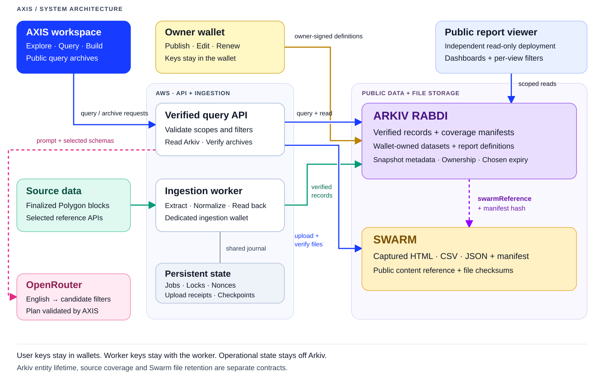

# AXIS architecture

[Editable diagram source](architecture.mmd) · [Full-size diagram](images/axis-architecture.svg) · [Deployment and operation](deployment.md)

## Read, verify, publish

The workspace and public report viewer are separate Next.js deployments. The workspace frontend proxies its API requests to the persistent AWS API. The public viewer has its own read-only report endpoints; it can load published definitions and query their permitted sources without the local workspace running.

The ingestion worker reads finalized Polygon blocks and selected reference/protocol sources. It normalizes records, writes them to Arkiv, reads them back and only then advances verified coverage. Bulk publication exposes a committed source prefix, not the next partially uploaded block. Its queue, signer coordination, nonce recovery and staging checkpoints stay on persistent disk.

Arkiv stores the published datasets, records, coverage manifests, report definitions and snapshot descriptors. A user's wallet signs changes to its own definitions. The ingestion wallet owns the records it publishes. The web server does not receive a user's wallet key or the worker's signing key.

Query Studio translates either manual controls or a reviewed English plan into scoped native predicates. OpenRouter receives the prompt and selected schemas, not stored record payloads. Its answer is validated before the server compiles a query. Returned numbers and chart values come from the Arkiv result.

For a public archive, the API exports the verified scope as HTML, CSV and JSON, uploads the collection to Swarm and checks its remote files. An Arkiv snapshot entity holds the public `swarmReference` and manifest checksum. Later reads use the captured files instead of substituting a new live query. The current archive flow rejects encrypted references containing embedded decryption keys.

## Trust and retention boundaries

| Boundary | What it means |
| --- | --- |
| User wallet vs ingestion wallet | Users own report/dataset definitions; a dedicated publisher owns imported records. |
| Public viewer vs workspace | Report endpoints accept only the source datasets referenced by that published report. |
| Source RPC vs Arkiv | Arkiv identifies the publisher and stores the data; it does not independently prove the source provider's completeness. |
| Arkiv vs Swarm | Arkiv holds queryable metadata and references. Swarm holds the larger archived files. Their retention is separate. |
| Published state vs local state | Drafts, read caches, locks and jobs support the workflow. They are not a replacement for published Arkiv records. |

Definitions and analytical records initially request a 30-day lifetime. Job status starts with seven days. Renewal must run to keep entities available. Readonly record attributes do not imply permanent availability, and a report definition can outlive its sources. Coverage/count checks reject missing data instead of quietly reducing a supposedly complete total. See the [schema and retention inventory](../arkiv/schema.md).

## Query performance

The server reuses its configured SDK reader and coalesces identical in-flight RPC calls. Up to eight node reads run concurrently per process, with a bounded queue. Independent coverage and alert checks run together. Count-only requests return no entity payload; schema probes return only a key and field schema. Transfer projections contain only the fields used by the table, provenance and analytics.

Large analytics/export scans divide the key space into four disjoint ranges, using cursor pagination within each. Results preserve key order, the original source predicate and the shared 20,000-row cap. A failed range rejects the result. Fresh coverage and final count checks remain in place. Each page reads the latest block; this is not a block-pinned database snapshot.

On one local live scope of 7,380 transfers, analytics improved from 51.4 seconds to 20.9 seconds. Decoded response text fell from 21.4 million to 9.5 million characters. A separate sequential scan matched every aggregate. These are observed measurements, not a guarantee for every source or a benchmark of the hosted deployment. [Reproduce the benchmark](../scripts/axis-read-benchmark.ts), [read the feedback](../arkiv/friction.md).

## Browser caching

Successful dataset, schema, preview and chart reads are reused in memory and the current tab's session storage. Copies are fresh for 30 seconds, or the view's shorter polling interval. Older copies render immediately while refreshing; copies older than five minutes are discarded on reuse. Explicit Execute/Refresh actions fetch fresh data, and successful writes invalidate cached reads.

The cache is bounded to 80 entries and about 3 MB. Keys include API namespace, owner, dataset/import scope, filters and pagination. Configuration, wallet challenges, RPC, worker status, translations, exports and mutations are not persisted. A failed refresh keeps the last successful visual with an error notice. API response headers remain `no-store`.

## Code map

| Location | Responsibility |
| --- | --- |
| `src/components/axis/` | Workspace, query editor, library, report builder and analytical charts |
| `src/lib/axis/store.ts` | Verified source scopes, entity reads, queries and exact analytical results |
| `src/lib/axis/arkiv-read.ts`, `key-scan.ts` | Bounded request sharing and parallel cursor scans |
| `src/lib/axis/ingestor.ts`, `bulk/` | Live imports, extraction, enrichment and verified bulk publication |
| `src/lib/axis/public-report.ts` | Published report and source-access boundaries |
| `src/lib/axis/english-query*.ts` | Structured translation and local query validation |
| `src/lib/axis/swarm*.ts` | Archive packaging, upload, linked reads and checksum verification |
| `scripts/`, `deploy/` | Workers, benchmarks, deployment, handoff and recovery |
